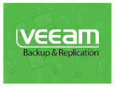
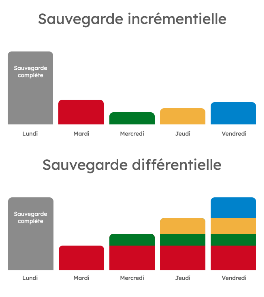

# Sauvegarde des VM avec Veeam Backup & Replication
<p align="center">
  
</p>

## Objectif

Mettre en place la solution de sauvegarde Veeam Backup & Replication
Community Edition afin de programmer les sauvegardes des machines
virtuelles du projet vers un NAS.

## Prérequis et installation

- Prévoyez une VM Windows (Server ou éventuellement Windows 10/11)
  avec suffisamment de RAM (8 Go minimum), de CPU et de stockage
  pour le logiciel.
- Téléchargez l’ISO « Veeam Backup & Replication Community Edition »
  depuis le site Veeam ou le communEleves.
- Montez l’ISO sur la VM, lancez `Setup.exe`, puis choisissez
  « Install Veeam Backup & Replication ».
- Acceptez la licence et cliquez sur `Next` sans fournir de licence
  pour rester en Community Edition (jusqu’à 10 workloads).
- Laissez l’installateur ajouter les composants manquants
  (SQL Express, .NET, etc.), conservez les ports et répertoires
  par défaut, puis poursuivez l’installation jusqu’à `Finish`.

## Première ouverture et configuration de base

- Ouvrez la console « Veeam Backup & Replication Console » depuis
  le menu Démarrer et connectez-vous au serveur local Veeam.
- Vérifiez en bas à droite que le produit est bien en
  « Community Edition ».

## Ajout de l’hôte ESXi

- Dans la console, allez dans :
  `Inventory → Virtual Infrastructure → Add Server → VMware vSphere → vSphere`.
- Indiquez l’adresse IP ou le FQDN de l’ESXi, puis un compte ayant
  les droits administrateur sur l’hôte pour permettre l’accès aux
  API de sauvegarde. Testez votre compte Active Directory du BTS SIO.
- Validez l’ajout et acceptez le certificat si demandé.
  Les VM de l’hôte apparaissent dans l’inventaire Veeam.

## Création d’un dépôt de sauvegarde

- Allez dans :
  `Backup Infrastructure → Backup Repositories → Add Repository`.
- Choisissez un dépôt « Direct attached storage » de type Windows,
  puis SMB, et pointez vers un dossier personnalisé sur le NAS SIO2 :

  ```text
  \\172.17.0.7\SIO2\SIO2-XX
  ```

- Nommez le dépôt `NAS-SIO2`.
- Utilisez les identifiants suivants :
  - Compte : `sauvegarde`
  - Mot de passe : `Btssio2017`
- Validez les réglages par défaut pour le format des fichiers et
  la limite de tâches, puis terminez l’assistant.

## Création d’un job de sauvegarde pour les VM

- Allez dans :
  `Home → Backup Job → Virtual machine`.

### Remarque : sauvegarde d’une VM ou d’un « computer »

- Sauvegarde d’une VM : Veeam passe par l’hyperviseur pour
  sauvegarder la machine virtuelle.
- Sauvegarde d’un « computer » : Veeam utilise un agent installé
  dans le système Windows ou Linux pour sauvegarder la machine
  de l’intérieur. Un « computer » peut donc être un ordinateur
  physique, mais aussi une VM : ce terme désigne ici la méthode
  de protection par agent, pas uniquement le type de matériel.

### Configuration du job

- Donnez un nom explicite à la tâche, par exemple :
  - `Backup-VM-SRV-AD`
  - `Backup-VM-Linux-SRV`
- À l’étape `Virtual Machines`, cliquez sur `Add` et sélectionnez
  les VM Windows et Linux sur l’hôte ESXi, ou un dossier complet
  si vous en utilisez.
- À l’étape `Storage`, choisissez le dépôt créé (`NAS-SIO2`) et
  définissez une politique de conservation simple, par exemple
  7 points de restauration.
- Configurez la planification à l’étape `Schedule`, par exemple
  toutes les semaines, le mardi soir à 23 h, et cochez l’option
  permettant d’exécuter le job automatiquement selon ce planning.
- Lancez manuellement le job une première fois sur une petite
  VM Linux pour montrer la progression, le débit et la durée.

### Remarque : sauvegardes complètes et incrémentielles
<p align="center">
  
</p>

La première exécution d’une tâche de sauvegarde Veeam est une
sauvegarde complète. Veeam enchaîne ensuite sur des sauvegardes
incrémentielles qui ne stockent que les blocs modifiés.

Cela permet d’optimiser le temps, la bande passante et l’espace
disque, tout en gardant la possibilité de restaurer une VM complète
à n’importe quel point de restauration.

Une chaîne est composée d’un full initial (`VBK`) et de ses
incrémentiels (`VIB`). Tant qu’un incrémentiel de cette chaîne
est encore « dans la fenêtre de rétention », Veeam garde toute
la chaîne, y compris le full.

## Créer un job avec plusieurs VM

- Dans l’onglet `Home` de la console Veeam, cliquez sur :
  `Backup Job → Virtual Machine → VMware vSphere`
  pour lancer l’assistant de nouveau job.
- Donnez un nom explicite au job, par exemple
  `Serveurs-Windows-SIO2-XX`, à l’étape `Name`, puis cliquez sur `Next`.
- À l’étape `Virtual Machines`, cliquez sur `Add`, puis sélectionnez
  plusieurs VM dans l’hôte ESXi avec `Ctrl + clic`, ou ajoutez un
  dossier ou un hôte complet si souhaité, puis validez.

## Tests de restauration

- Dans `Home → Backups → Disk`, sélectionnez un job réussi,
  puis faites un clic droit sur une VM sauvegardée.
- Testez les actions ci-dessous :
  - `Restore Entire VM` : restaurer entièrement une VM.
  - `Instant VM Recovery` : démarrer la VM directement depuis
    la sauvegarde.
  - `Restore guest files (Windows/Linux)` : récupérer des fichiers
    à l’intérieur de la VM.